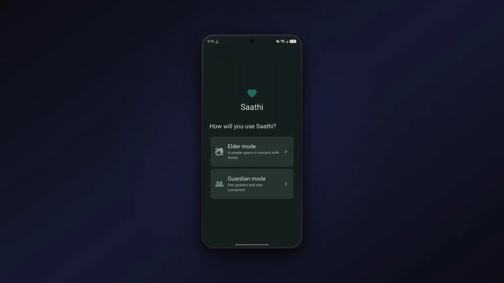
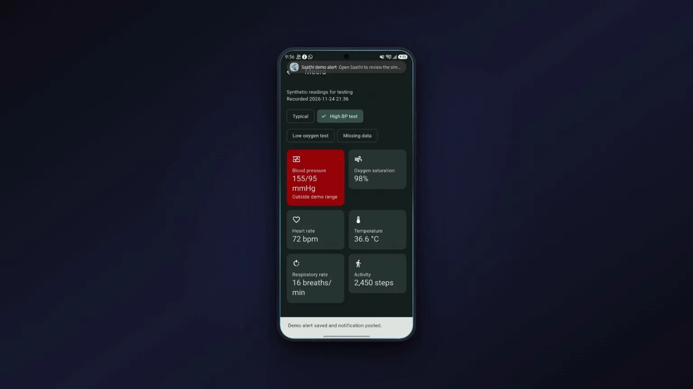
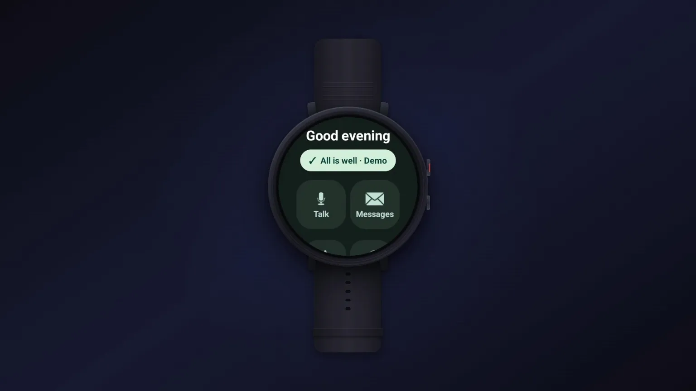

# Saathi

**An Android companion for older adults and the family members who check in on them.**

Saathi brings two everyday needs into one app. Older adults get a simpler phone interface and a way to reach family. Guardians get a dashboard for reviewing alerts, seeing what changed and when, and deciding when to follow up.

Built by **Team Vortex** at **Global Academy of Technology** for the **wHACKiest 2026** online ideathon, **Know Thyself** track, 26–27 November 2026.

[Screenshots](#screenshots) · [Features](#features) · [Demo walkthrough](#demo-walkthrough) · [Architecture](#architecture) · [Run locally](#run-locally) · [Pilot and roadmap](#pilot-and-roadmap)

## Screenshots

### Android mode picker

Choose Elder mode for a simpler phone experience or Guardian mode to review updates.



### Guardian alert demo

A simulated high blood pressure reading is flagged in the dashboard and generates a local Android notification.



### Wear OS companion

The watch home screen shows a greeting, a demo wellness status, and large Talk and Messages tiles.



## Why Saathi

When older adults live independently and their children, relatives, or carers visit occasionally, an unusual reading can go unnoticed until the next call. A wearable can collect readings, but a family member also needs enough context to decide whether to check in. For example, a daughter could open an alert, see which reading changed and when it was recorded, and call her mother to follow up.

| Approach | Primary purpose | What family can do |
| --- | --- | --- |
| Wearable app | Show readings from a watch | Review shared readings where the wearable supports sharing |
| Simple Android launcher | Make essential apps and calls easier to find | Help set up a simpler phone home screen |
| Saathi | Bring a readings dashboard and an accessible home screen together | Review a flagged reading and its time in the demo, or receive messages from a connected family member with the backend configured |

## Features

| Feature | What is available on `main` |
| --- | --- |
| **Guardian dashboard** | A connected-elder list and a separate, labeled demo with fictional profiles Meera and Ravi. The demo shows blood pressure, oxygen saturation, heart rate, temperature, respiratory rate, and steps. High blood pressure and low oxygen scenarios create timestamped alert history and local Android notifications. There are also typical and missing-data scenarios. |
| **Elder mode** | A time-of-day greeting, a compact wellness overview based on Meera’s demo readings, and large action tiles. Theme settings offer System, Light, and Dark. Language settings offer English, Tamil, Kannada, Telugu, and Malayalam. Guardian demo copy and some settings and notifications use English. |
| **Android Home launcher** | An optional Home app with large tiles, saved contact shortcuts, and pinned apps. Minimal mode keeps the home screen compact. Normal mode adds an app drawer with an optional preferred-app list. The launcher keeps the Android wallpaper visible around the tiles. |
| **Voice message drafts** | In the regular Elder mode, **Talk to Saathi** can transcribe speech or accept typed text, then read the draft aloud. The elder chooses a connected guardian and confirms before sending. Recognition and playback depend on the device’s speech services. The launcher’s assistant entry is a preview. |
| **Accounts and family connections** | With Supabase configured, users can sign in and connect using a short-lived code generated by the elder. Either connected user can revoke the pairing. Messages can be retrieved through **Saathi connections**. Google sign-in requires provider configuration and device verification. |
| **SOS** | The Elder launcher has a three-second SOS hold and a five-second cancel countdown. After the countdown, it attempts to notify connected guardians and can add a recent approximate location if available. With SOS demo mode disabled, it opens Android’s dialer with [India’s emergency number, 112](https://www.mha.gov.in/emergency-response-support-system-erss), ready for the user to press Call. |
| **Wear OS companion** | An Elder-only watch app with a simplified home screen, app shortcuts, and voice or typed drafts. The watch can request a draft handoff for review and sending on the paired phone. The watch Home role has been exercised on the API 33 emulator. Paired handoff, physical watch compatibility, and default-assistant invocation still need end-to-end verification. |

The health monitor uses synthetic readings and demo thresholds. Live smartwatch imports, automatic remote health alerts, incoming-message read-aloud, and the dedicated family callback flow are planned. The current voice draft can carry a manual callback request. Remote push code currently handles saved messages, including SOS messages, and still needs a two-phone delivery test.

## Demo walkthrough

The ideathon demo covers a flagged reading, the Guardian alert, a voice draft, and SOS without placing an emergency call.

1. **Show the alert.** Sign in, allow Android notifications, and open **Guardian mode → Meera → High BP test** or **Low oxygen test**. Open **Alerts** to show the affected reading and timestamp. Try **Missing data** to show the unavailable state.
2. **Show the elder’s view.** Switch to **Elder mode** and show how Meera’s overview reflects the selected scenario. Choose **Typical** in Meera’s Guardian profile to reset the demo.
3. **Draft a family message.** In the regular Elder mode, open **Talk to Saathi**, speak or type a short callback request, and use **Read draft aloud**. To demonstrate sending, use two test accounts, connect them, and choose **Open messages** in **Saathi connections** on the recipient’s phone. Refresh to check the inbox.
4. **Show SOS cancellation.** In Elder Settings, choose **Use Saathi as Home** and keep **SOS demo mode** enabled. Hold SOS for three seconds and cancel during the countdown. With demo mode enabled, the dialer stays closed. Letting the countdown finish can still send real messages to connected guardians, so use dedicated test accounts if demonstrating that step.

## Architecture

| Flow | Data path | Status |
| --- | --- | --- |
| Health alert demo | Synthetic reading → Flutter demo rule → local alert history and Android notification → Guardian opens the event and reviews the reading and time | Runs on one phone |
| Live monitoring | Compatible watch → manufacturer’s companion app → Health Connect → Saathi checks the alert rule → remote phone notification → Guardian reviews the reading and time | Watch imports and remote health alert flow are planned |
| Family messaging | Elder speaks or types → reviews the draft and confirms the guardian → Supabase saves the message → the app requests Firebase Cloud Messaging (FCM) delivery → Guardian can open the protected inbox | Requires backend configuration. Two-phone push verification is pending |
| Watch draft | Wear OS voice or text input → Wear Data Layer → paired Android phone stores the draft → elder reviews, selects the guardian, and sends | Handoff code is present. Paired-device verification is pending |

Flutter and Dart power the phone UI. Kotlin handles Android settings, launcher entry points, notifications, speech, and device actions. The separate Wear OS module uses Java and Google Play services. Supabase provides authentication, PostgreSQL access rules, pairing, and messages. A Supabase Edge Function requests FCM delivery. AWS Lambda is proposed for future processing and weekly reports.

### Sharing and delivery

The elder creates the pairing code and chooses whom to share it with. The code expires after 10 minutes and can be used once. Supabase row-level policies restrict message access to participants in an accepted pairing. FCM uses a generic notification body, with the message text available in the authenticated inbox.

Message storage and push delivery are separate steps. If push fails or the sender closes the app before requesting it, the recipient can still refresh the inbox for a saved message. The current design uses server-side access controls. End-to-end encryption and user-controlled sharing of live health data are future work.

## Run locally

Use Flutter with a Dart SDK compatible with [`pubspec.yaml`](pubspec.yaml), Android Studio and its Android SDK, and a full JDK with `javac`. The phone app targets devices and emulators running **Android 13 (API 33) or later**. Use `flutter doctor -v` to verify the SDK and Java paths. If Flutter picked the wrong JDK, set it with `flutter config --jdk-dir <path-to-jdk>`.

```sh
git clone https://github.com/teem-vortex/saathi.git
cd saathi
flutter doctor -v
flutter pub get
```

### Accounts, pairing, and the health demo

Both in-app modes require a Supabase session, even when using synthetic health readings. Firebase is optional for the local health demo and in-app messaging.

1. Create a Supabase project. Apply the two [SQL migrations](supabase/migrations) in filename order. Enable email/password sign-in and confirm the test accounts if email confirmation is enabled.
2. Start an Android emulator or connect a phone, then run the app with the project URL and its client key.

   ```sh
   flutter run \
     --dart-define=SUPABASE_URL=https://YOUR_PROJECT.supabase.co \
     --dart-define=SUPABASE_ANON_KEY=YOUR_PUBLISHABLE_OR_ANON_KEY
   ```

3. To connect two accounts, open **Elder mode → Settings → Saathi connections → Code for guardian**. On the guardian account, enter the code in **Guardian mode → Settings → Saathi connections**. Return to the Guardian dashboard and refresh **Connected elders** if needed.

For Google sign-in, create a Google OAuth **Web application** client and register the Google provider callback shown by Supabase as an authorized redirect URI. Set the client ID and secret in the Supabase Google provider settings. Add `com.teemvortex.saathi://login-callback/` to Supabase’s allowed redirect URLs. If the Google consent screen is in testing, add your accounts as test users. Keep the Google client secret and Supabase service-role key on the server.

### Remote notifications

1. Register the Android app with Firebase using package ID `com.example.saathi`. Download its `google-services.json` to `android/app/google-services.json` for a local build. Git ignores this file.
2. Deploy the [`notify-message` Edge Function](supabase/functions/notify-message/index.ts) and set `FIREBASE_SERVICE_ACCOUNT` in Supabase’s function secrets. Keep the service account out of the client and repository.
3. Build with the Supabase defines above plus `FIREBASE_API_KEY`, `FIREBASE_APP_ID`, `FIREBASE_MESSAGING_SENDER_ID`, and `FIREBASE_PROJECT_ID`. On Windows, the [PowerShell build helper](tool/build_mvp.ps1) reads the Firebase values from the JSON file.

   ```powershell
   $env:SUPABASE_ANON_KEY = '<your Supabase publishable/anon key>'
   .\tool\build_mvp.ps1 -SupabaseUrl 'https://YOUR_PROJECT.supabase.co'
   ```

4. Allow notifications on both phones, connect the accounts, and confirm that a sent message appears in the recipient’s inbox. Check push delivery independently with the recipient’s app in the background.

### Wear OS build

Use a **Wear OS 4 / API 33 or newer** device or emulator. Install Android SDK Platform 36 for the watch build. Open the [Android Gradle project](android) in Android Studio and select the `wear` run configuration, or run `:wear:assembleDebug` from the Gradle tool window. For a paired test, install the phone and watch builds with the same application ID and signing certificate, then use **Review on phone** from the watch draft screen. The elder reviews and sends the draft from the phone.

### Development checks

```sh
dart format --output=none --set-exit-if-changed lib test
flutter analyze
flutter test
```

| Path | Contents |
| --- | --- |
| [`lib/`](lib) | Flutter UI, demo rules, connections, draft messaging, SOS, and push registration |
| [`android/app/`](android/app) | Phone build and native Android integrations |
| [`android/wear/`](android/wear) | Wear OS companion |
| [`supabase/`](supabase) | SQL migrations and notification function |
| [`test/`](test) | Flutter tests |
| [`AI-Wiki/`](AI-Wiki/Home.md) | Project design, decisions, device verification, and work log |

## Pilot and roadmap

Start with **one supported watch and two Android phones**. Verify which readings the watch’s companion app exports, how fresh those records are, and what happens when data is missing or stale. Measure the time from a flagged reading to a Guardian notification, delivery success, and callback-request completion. Track watch setup and family follow-up during the pilot.

- **Health Connect and alerts.** Import supported, consented records. Show the reason and timestamp for each alert, flag stale or missing data, and give elders control over sharing. Validate remote delivery, background monitoring, and recovery after a restart.
- **Everyday assistance.** Add spoken playback of received messages, a dedicated callback request, and connected voice assistance. Verify default-assistant behavior and watch shortcuts on physical devices.
- **Reporting and care workflows.** Explore localized AI summaries and weekly reports using approved readings, with AWS Lambda as a proposed processing option. Pilot with local senior communities and home-care partners before expanding to care teams and more devices.

The proposed model starts with families already using or buying a compatible smartwatch for an older relative. The core experience would be free, with paid weekly reports or additional caregiver accounts as options to test. Early costs include cloud processing, device testing, and onboarding support. Pilot feedback will guide pricing and watch compatibility.

## Team Vortex

**Vikas G** (team lead) · **Vinay G** · **Ajay Gowda H** · **Vinnavan Newton E**

Global Academy of Technology · Department of Computer Science and Engineering · wHACKiest 2026

## License

Saathi is released under the [GNU General Public License v3.0](LICENSE).
